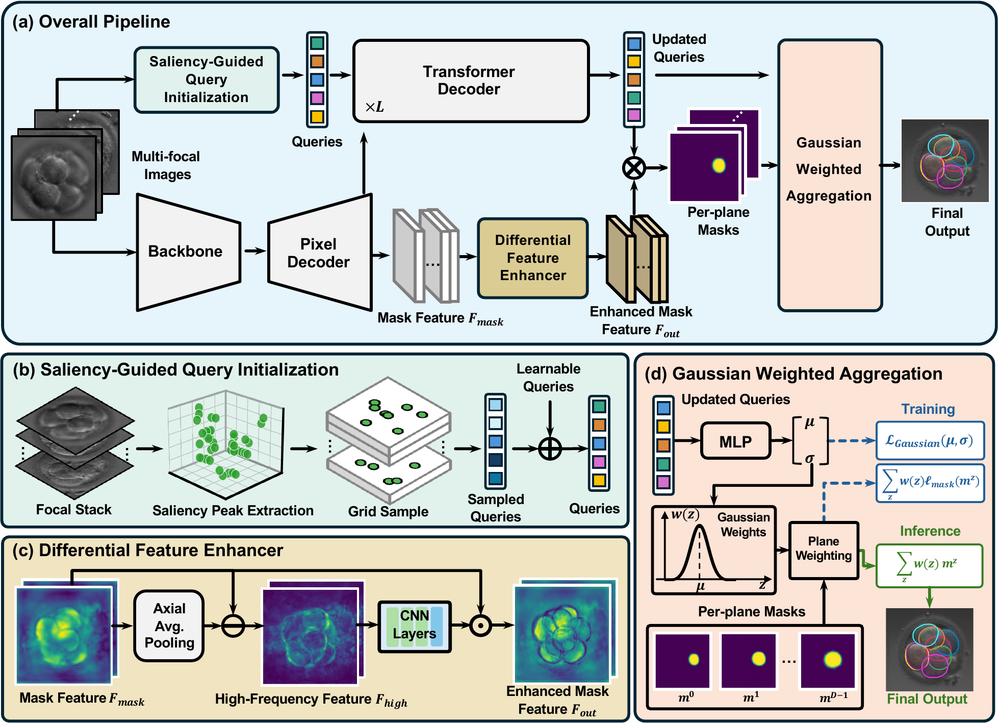

# FocusFormer

Official PyTorch implementation of **"Focus-Aware Transformer for Instance Segmentation of Overlapping Cells in Multi-Focal Microscopy"**.

FocusFormer segments overlapping cells from multi-focal image stacks. Built on Mask2Former, it adds three focus-aware modules:

- **SQI** (Saliency-Guided Query Initialization): initializes object queries at salient structures in the focal stack instead of using random queries.
- **DFE** (Differential Feature Enhancer): computes axial differences of pixel-decoder features across focal planes and calibrates them with a learned spatial gate.
- **GWA** (Gaussian Weighted Aggregation): predicts a Gaussian focus profile (center $\mu$, width $\sigma$) for each instance and aggregates its per-plane masks accordingly.

Two backbones are supported: ResNet-50 (main model) and the SAM 2 Hiera-S image encoder (used for the backbone-matched comparison with EntitySAM).

<p align="center">
  
</p>

## Repository structure

```text
train.py                      # training
test.py                       # evaluation on the test split
shell/train.sh                # training launcher
shell/inference.sh            # evaluation launcher
configs/                      # model configs (ResNet-50 and Hiera-S)
focusformer/
  model.py                    # FocusFormer meta-architecture
  modeling/
    transformer_decoder.py    # transformer decoder with the SQI, DFE, and GWA modules
    pixel_decoder.py          # multi-scale deformable attention pixel decoder
    head.py                   # segmentation head
    criterion.py, matcher.py  # losses and Hungarian matching
    backbone/                 # SAM 2 Hiera-S backbone
    ops/                      # multi-scale deformable attention CUDA operator
  data/                       # focal-stack loading, augmentation, and saliency peaks for SQI
  engine.py                   # trainer and config setup
```

## Installation

Tested with Python 3.10, PyTorch 2.5.1 (CUDA 12.4), torchvision 0.20.1, and Detectron2 0.6 on Linux.

```bash
conda create -n focusformer python=3.10 -y
conda activate focusformer

# 1. PyTorch (choose the build matching your CUDA version)
pip install torch==2.5.1 torchvision==0.20.1 --index-url https://download.pytorch.org/whl/cu124

# 2. Detectron2 (build from source)
pip install 'git+https://github.com/facebookresearch/detectron2.git'

# 3. Other dependencies
pip install -r requirements.txt

# 4. Multi-scale deformable attention CUDA operator
cd focusformer/modeling/ops
python setup.py build install
cd -
```

## Data preparation

FocusFormer was evaluated on two datasets with five-fold cross-validation:

- **Embryo**: private cleavage-stage embryo dataset with 11 focal planes per stack. It is not publicly available.
- **CISD**: public Cell Instance Segmentation Dataset of overlapping urothelial cells with 21 focal planes per stack, available at [Zenodo](https://zenodo.org/records/5938893).

The loader expects the following layout:

```text
data/
  embryo/  (or cisd/)
    images/                         # one .npy focal stack per sample, shape (Z, H, W)
    annotation/
      split_1/train.json
      split_1/test.json
      ...
      split_5/train.json
      split_5/test.json
```

Annotations follow the COCO instance format, with additional per-instance focus fields read by `focusformer/data/dataset_mapper.py`. Each `.npy` stack is stored as (Z, H, W), with Z = 11 for Embryo and Z = 21 for CISD. The full ordered stack is always used.

## Pretrained weights

- **ResNet-50**: the base config uses the Detectron2 ImageNet-pretrained ResNet-50, which is downloaded automatically.
- **Hiera-S**: download `sam2.1_hiera_small.pt` from the [SAM 2 repository](https://github.com/facebookresearch/sam2) and place it at `checkpoints/sam2.1_hiera_small.pt`, or set `MODEL.HIERA.CHECKPOINT`.

## Training

```bash
# bash shell/train.sh <dataset> <fold> <backbone>
bash shell/train.sh embryo 1 r50
bash shell/train.sh cisd 1 hiera_s
```

```bash
python train.py --config-file configs/focusformer_r50.yaml --dataset embryo --split 1 \
  --data_root data --output_dir work_dirs/embryo/r50/split_1
```

## Evaluation

```bash
# bash shell/inference.sh <dataset> <fold> <backbone>
bash shell/inference.sh embryo 1 r50
```

```bash
python test.py --weights /path/to/run/model_final.pth --split 1 --data_root data --output_dir /path/to/eval
```

<!-- ## Citation

If you find this work useful, please cite:

```bibtex
@article{sun2026focusformer,
  title   = {Focus-Aware Transformer for Instance Segmentation of Overlapping Cells in Multi-Focal Microscopy},
  author  = {Sun, Chen and Liu, Hang and Shan, Guanqiao and Yang, Mo and Liu, Daohui and Chen, Lei and Wang, Shanshan and Sun, Haixiang and Sun, Yu},
  journal = {IEEE Journal of Biomedical and Health Informatics},
  year    = {2026}
}
``` -->

## License

This project is released under the [MIT License](LICENSE).

## Acknowledgements

This code builds on [Mask2Former](https://github.com/facebookresearch/Mask2Former) (MIT License), [Detectron2](https://github.com/facebookresearch/detectron2), and [SAM 2](https://github.com/facebookresearch/sam2) (Apache License 2.0). Their license texts are in `NOTICE`.
